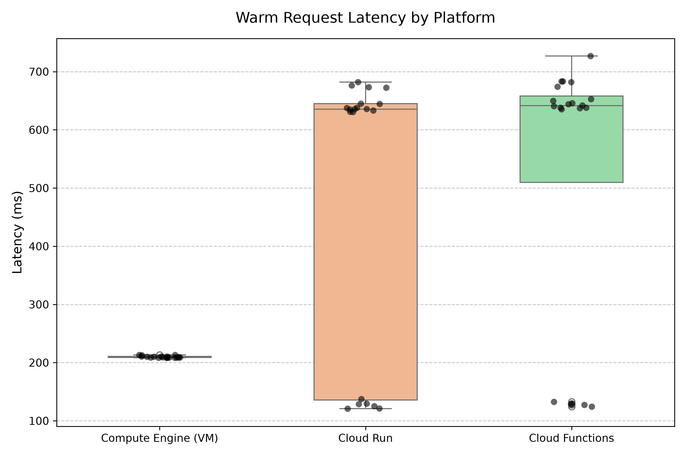

# Phase 1 — Comparison Report

Copy this file to `submission/phase1_report.md`, fill in every answer slot, and commit it:

```bash
cp phase-1-echo-bot/report_template.md submission/phase1_report.md
```

**How to fill it in.** Each answer sits between a pair of `<!--answer:...-->` markers. Replace
the `TODO` line with your answer — **leave the markers themselves untouched**, they are how the
grader finds your answers. Anything you write outside the markers is ignored, so add extra
prose, tables or images freely.

Numbers must **match `submission/phase1_report.json`** exactly — that file is produced by
`measure.py` and is what your figures are checked against. Copy them across; do not retype from
memory.

---

## 1. Setup facts

**Your image size**, in MB, from `gcloud artifacts docker images list` (number only, e.g. `142`):

<!--answer:image_size_mb-->
47.7
<!--/answer-->

**The custom VPC and subnet you created** (names only):

<!--answer:vpc_name-->
echo-net
<!--/answer-->

<!--answer:subnet_name-->
echo-subnet
<!--/answer-->

---

## 2. Measurements

Copy these from `submission/phase1_report.json`. Cold is `cold_ms`; warm median is
`stats.median`. Numbers only, in milliseconds (e.g. `812.4`).

| Platform | Cold (ms) | Warm median (ms) |
|---|---|---|
| IaaS VM | <!--answer:vm_cold_ms-->250.6<!--/answer--> | <!--answer:vm_warm_median_ms-->209.0<!--/answer--> |
| Cloud Run | <!--answer:cloudrun_cold_ms-->2268.6<!--/answer--> | <!--answer:cloudrun_warm_median_ms-->635.4<!--/answer--> |
| Cloud Function | <!--answer:function_cold_ms-->1798.7<!--/answer--> | <!--answer:function_warm_median_ms-->641.5<!--/answer--> |

Include your histogram or plot of the warm distribution below (an image, or the ASCII chart
`measure.py` prints). This is read by a human, not the grader:

<!--answer:latency_plot-->

<!--/answer-->

---

## 3. Per-platform analysis

**Scaling behaviour.** Imagine requests arriving one at a time, then ten at once, then a
hundred. For each of the three platforms, answer concretely:

- Does anything get created automatically to absorb the load — and if so, *what* exactly?
  (One platform here creates nothing at all.)
- What is the hard limit, and where does it come from — a flag you passed yourself, or the
  size of the machine you picked?

(~80 words. Your `--machine-type=e2-micro` and `--max-instances=3` are both concrete answers
to the second question.)

<!--answer:scaling_behaviour-->
#### IaaS Path
* Nothing is created automatically, the container I have deployed handles all traffic
* The limit here is the resources allocated to the container and the resources allocated to the VM instance (e2-micro has 0.25-2 vCPU and 1GB of memory)

#### PaaS Cloud Run Path
* Under rising traffic, the service creates new container instances automatically.
* The limit of the container instances is 3 from `--max-instances=3` and 80 requests/instance (default config)

#### Serverless Function Path
* For rising traffic, new instances are created automatically.
* The limit here is 12 (default configuration) and 1 request/instance (also default config)
<!--/answer-->

**Deployment effort.** What did you have to build, configure and maintain to get each of the
three running? (~100 words)

<!--answer:deployment_effort-->
#### IaaS Path
* I had to deploy a custom VPC, with a single subnet and two custom firewall rules that permit *TCP Traffic from anywhere on ports 22 and 8080 for instances with the network tag `echo-http`*.
* I had to spin up an instance, create a new network interface for the custom VPC subnet I had just created. I also had to give this instance the requested network tag `echo-http` so that it can inherit the firewall rules.
* I used the SSH button on the Google Cloud Compute Engine console to connect to the VM
* I installed and authenticated docker on the instance
* I pulled and then ran the image from artifact registry

#### PaaS Cloud Run Path
* I just ran this command `gcloud run deploy echo-bot --image=$REGION-docker.pkg.dev/cloudslab/eurecomgpt/echo-bot:v1 --region=$REGION --port=8080 --min-instances=0 --max-instances=3 --allow-unauthenticated` (this required the image to have been uploaded to the Artifact Registry)

#### Serverless Function Path
* I just ran `gcloud functions deploy echo --gen2 --region=$REGION --runtime=python311  --source=. --entry-point=echo --trigger-http --allow-unauthenticated` (this required no docker image, just source code) I forgot to explicitly mention this but the minimum number of instances is 0 by default.

<!--/answer-->

---

## 4. Why do two of your three numbers look alike?

With Cloud Run and your Function both deployed, run `gcloud run services list` and paste the
**complete output** here, unedited:

<!--answer:run_services_list-->
```
✔
SERVICE: echo
REGION: us-central1
URL: https://echo-76935586958.us-central1.run.app
LAST DEPLOYED BY: service-76935586958@gcf-admin-robot.iam.gserviceaccount.com
LAST DEPLOYED AT: 2026-10-18T19:38:40.289344Z

✔
SERVICE: echo-bot
REGION: us-central1
URL: https://echo-bot-76935586958.us-central1.run.app
LAST DEPLOYED BY: Andrei-Eugen.Bratu@eurecom.fr
LAST DEPLOYED AT: 2026-10-18T19:29:16.047540Z
```
<!--/answer-->

Now explain what that output tells you about how your Function is actually being run, why its
cold start resembles Cloud Run's so closely, and what — if anything — genuinely differs between
the two deployment paths. (~120 words)

<!--answer:convergence_explanation-->
The documentation says that *A function is a Cloud Run service that is deployed from source code*, which shows that the underlying scaling infrastructure is the same. The comparisson here is not completely fair since **Task 7** does not state to limit the number of instances to 3 and also the Cloud Run deployment is allowed to handle concurrent requests per instance. The convergence is explained by the fact that the function and Cloud Run service are the same service. There is another key difference, which is the container image: for the Cloud Run Service, our image with `gunicorn` is what is deployed, while for the function the code is packaged into a container by **Buildpacks** automatically (which is somehow 5.5MB and also has a 4.1MB cache - the numbers were extracted from the Artifact Registry entries created when deploying the function).
<!--/answer-->
